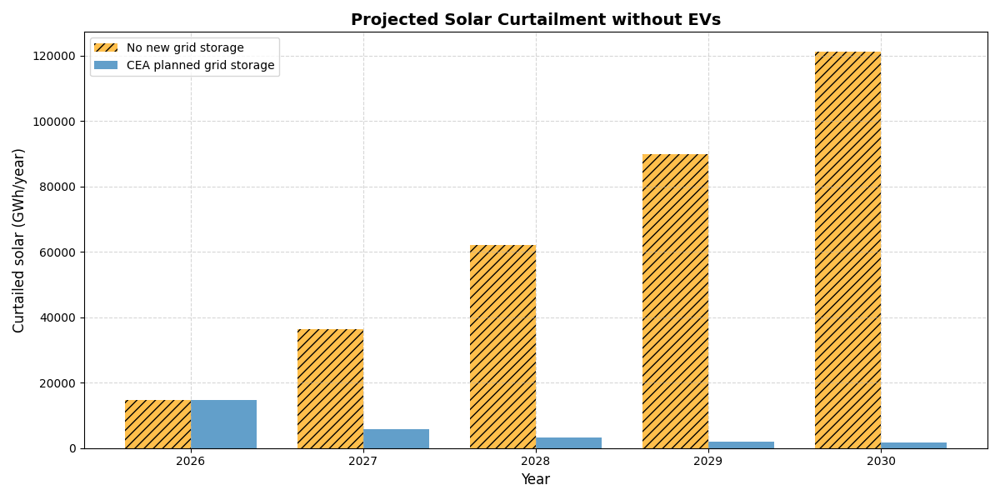
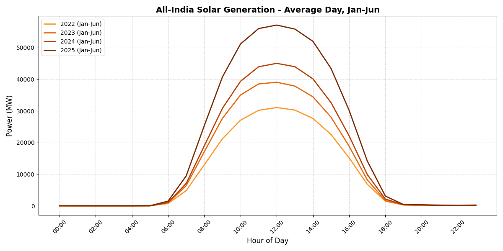
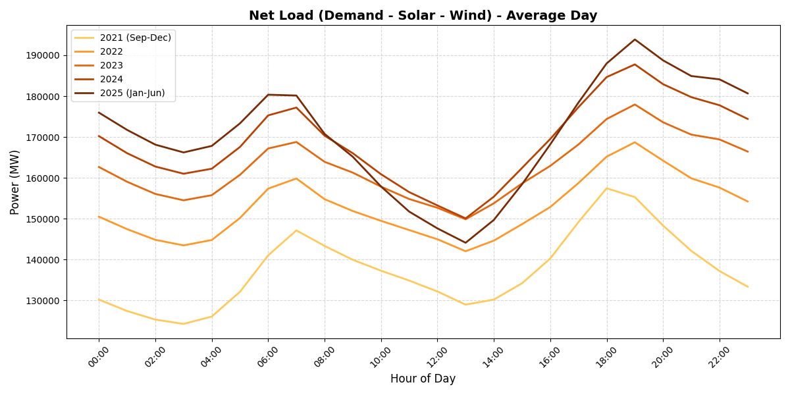
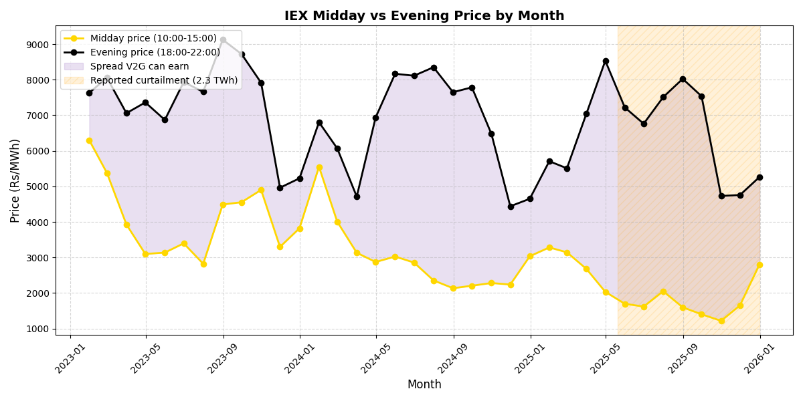
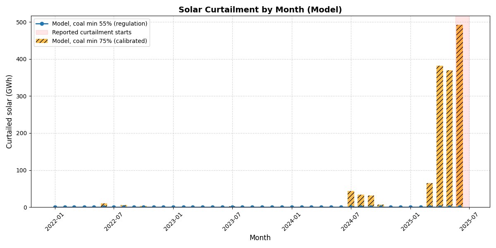
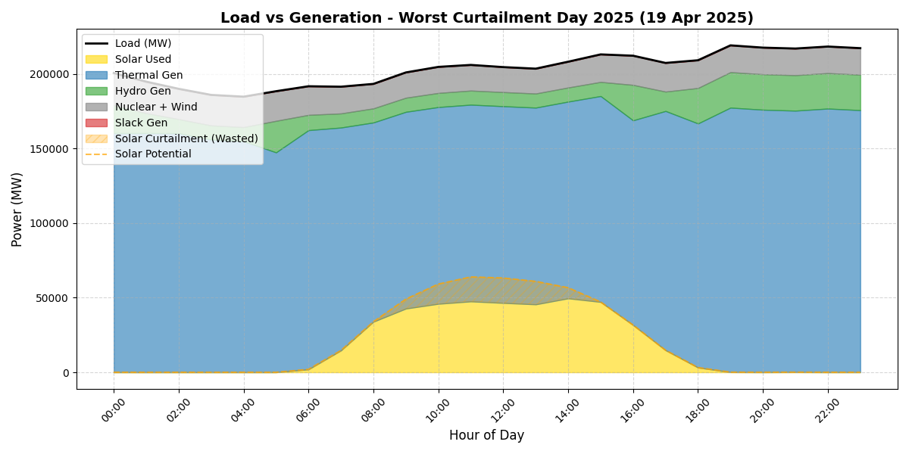
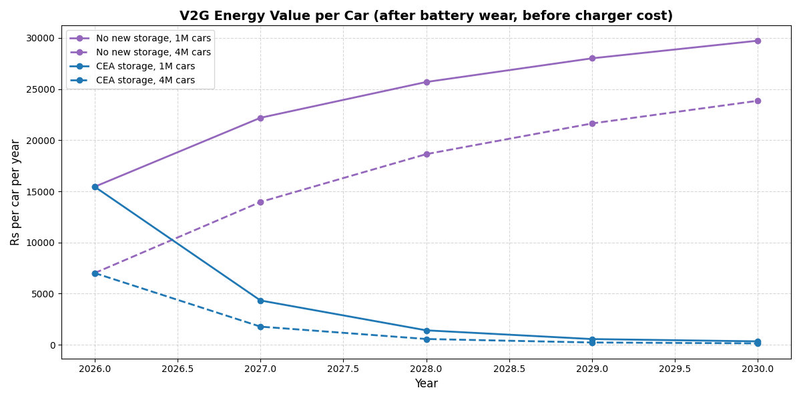

# Solar Curtailment in India and the Financial Feasibility of Vehicle-to-Grid (V2G)

**Team V2G:** Ayuwan · Dev Arora · Bharath Sreejith · Uditi R

**Question:** Is Vehicle-to-Grid financially viable in India, and under what conditions?

**Answer:** Yes, today. Whether it *stays* viable depends on one decision: whether India builds the grid-scale batteries in CEA's plan.

- **2026:** each V2G car creates about ₹15,450 a year of system value after battery wear, against ₹10,765 a year for its bidirectional charger. That's a net **₹4,700 per car** and a **4-year payback**.
- **By 2030, if the planned grid batteries are not built,** the net rises to **₹19,000 per car**.
- **By 2030, if they are built,** V2G **loses ₹10,400 per car** a year.



---

## Key findings

| | Result |
|---|---|
| Solar curtailed (model), 2022 → 2023 → 2024 → Jan–Jun 2025 | 20 → 3 → 116 → **1,308 GWh** |
| Reported curtailment, Apr–Jun 2026 | 8,133 GWh (used to calibrate the model) |
| Coal minimum load that reproduces it | **75%** (regulation: 55%; at 55% there is no curtailment) |
| IEX midday hours below ₹2/kWh, 2023 → 2025 | 4% → **48%** |
| IEX evening-minus-midday spread, 2023 → 2025 | ₹3.3 → **₹4.5 per kWh** |
| V2G net per car, 2026 (energy only) | **+₹4,687 / yr**, 4.2-yr charger payback |
| V2G net per car, 2030, no new grid storage | **+₹18,967 / yr**, 2.1-yr payback |
| V2G net per car, 2030, CEA storage built | **−₹10,431 / yr** |

1. **Curtailment didn't decrease. It started in 2025.** It was near zero until 2024 and has risen sharply since March 2025.
2. **The cause is inflexible coal, not too much solar.** Coal plants committed for the evening peak can't turn down below about 75% at noon.
3. **The market shows the same thing.** Midday IEX prices collapsed while evening prices stayed high, and the model's value per exported kWh matches that spread.
4. **Grid batteries and V2G compete for the same midday surplus.** V2G is an alternative to part of the planned battery build-out, not an add-on to it.

---

## Method

Everything runs in [`code.ipynb`](code.ipynb), five cells in order. Each cell saves its tables to `results/` and its charts to `figures/`.

| Cell | What it does | Main outputs |
|---|---|---|
| 1 | Loads all Grid-India files (raw SCADA exports and the hourly file) plus IEX DAM data into clean hourly tables | `01_grid_hourly.csv`, `01_iex_hourly.csv`, `01_coverage_by_month.csv` |
| 2 | Cleans feed dropouts, frozen solar and sensor spikes, then builds solar (per MW installed), demand and net-load curves for each year | `02_yearly_summary.csv`, `02_grid_hourly_clean.csv`, figures `02*` |
| 3 | IEX evidence of the midday surplus: prices, sell/buy bids, noon-vs-evening spread, price vs net load | `03_iex_yearly_summary.csv`, figures `03*` |
| 4 | Daily least-cost dispatch (linear program, HiGHS via SciPy) with a coal minimum load, calibrated to the reported Apr–Jun 2026 curtailment and run for every day from 2022 to Jun 2025 | `04_yearly_curtailment.csv`, `04_monthly_curtailment.csv`, figures `04*` |
| 5 | Projection for 2026–2030, with and without CEA's planned grid storage, comparing an EV fleet on smart charging (V1G) with V2G | `05_projection_no_ev.csv`, `05_v2g_results.csv`, figures `05*` |

### Financial feasibility (from `05_v2g_results.csv`, 1 million cars)

**Fixed cost per car per year:**
- Bidirectional charger: ₹60,000 × capital recovery factor 0.1627 (10 years, 10%) = **₹9,765**
- Aggregator platform: **₹1,000**
- Total: **₹10,765**

**Battery wear:** ₹2.5 per kWh drawn from the battery (LFP: ₹10,000/kWh ÷ 4,000 cycles). This is charged inside the dispatch, so cars only export when it pays.

**Capacity value:** each car can firmly supply 3.6 kW at the evening peak (50% of cars plugged in × 7.2 kW). At the 4-hour BESS tender price of ₹2.85 lakh/MW/month, that's worth ₹12,312 per car per year.

| Year | Grid storage | Energy value | Net, energy only | Net + capacity | Payback |
|---|---|---|---|---|---|
| 2026 | either | ₹15,452 | +₹4,687 | +₹16,999 | 4.2 yr |
| 2028 | none built | ₹25,693 | +₹14,928 | +₹27,240 | 2.4 yr |
| 2030 | none built | ₹29,731 | +₹18,967 | +₹31,279 | 2.1 yr |
| 2028 | CEA plan | ₹1,411 | −₹9,354 | +₹2,959 | never |
| 2030 | CEA plan | ₹334 | −₹10,431 | +₹1,881 | never |

---

## Selected figures

| | |
|---|---|
|  |  |
|  |  |
|  |  |

All 24 figures are in [`figures/`](figures/).

---

## How to run

```bash
pip install -r requirements.txt
jupyter notebook code.ipynb
```

- **Cells 2–5 run as they are.** The cleaned hourly data they need (`results/01_grid_hourly.csv`, `results/02_grid_hourly_clean.csv`) is included in the repo.
- **To rerun Cell 1 from raw data,** download the Grid-India files first (about 700 MB, not included). See [`data/mendeley_raw/README.md`](data/mendeley_raw/README.md).
- **Cell 5 reuses functions from Cell 4,** so run Cell 4 first in the same session. Cell 5 takes about 5 minutes.

## Repository structure

```
code.ipynb               main analysis (5 cells, outputs saved)
requirements.txt
data/
  iex/csv_data/          IEX Day-Ahead Market, 15-min, 2023-2025
  mendeley_raw/          (empty) download instructions for Grid-India SCADA data
results/                 every table the notebook produces
figures/                 every chart the notebook produces
```


## Data sources

- **Grid-India SCADA** (demand, solar, wind, coal, hydro, gas, nuclear), Sep 2021 – Jun 2025: [Mendeley Data, doi:10.17632/y58jknpgs8.2](https://data.mendeley.com/datasets/y58jknpgs8/2), CC BY 4.0
- **IEX Day-Ahead Market**, 2023–2025: [iexindia.com](https://www.iexindia.com/)
- **NITI Aayog ICED load curves** (cross-check): [iced.niti.gov.in](https://iced.niti.gov.in/energy/electricity/distribution/national-level-consumption/load-curve)
- **Other published figures:** capacity, CEA plans, reported curtailment, battery and charger costs. Each is cited in the notebook cell headers and in the project report.

## Limitations

- India is modelled as one grid with no transmission limits. The calibrated 75% coal minimum therefore stands in for both coal inflexibility and transmission bottlenecks.
- 2026–2030 reuse Jul 2024 – Jun 2025 weather and demand shapes, scaled up to each year.
- The 2026 average solar capacity used is 150 GW. The 171.05 GW installed on 31 Aug 2026 implies about 160 GW, so the 2026 results here are slightly conservative.
- EV behaviour (plug-in rates, distance driven) is assumed.

## Declaration

Claude (Anthropic) was used to help write the analysis code and draft the documentation. The data, project direction, modelling choices and final review are the team's own.

## License

Code: [MIT](LICENSE). Data belongs to its original publishers under their own terms.
